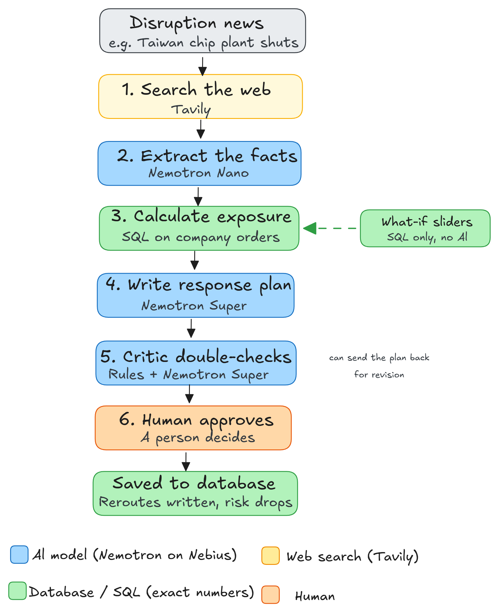

# CrisisSentinel

When a factory shuts down or a port closes, CrisisSentinel tells a manufacturer which of its orders are at risk, how much money is involved, and what to do about it. A human approves the final plan.

[](LICENSE)

Built for the Nebius x NVIDIA Global AI Hackathon, **Best Apps and Agents** track.

- **Demo video (3 min):** https://www.youtube.com/watch?v=RvS_1QmGDUk

## The problem

Say a chip factory in Taiwan shuts down. A car maker needs answers fast: does this hit us, how badly, and what do we do?

News tells you what happened. It does not tell you that purchase order PO10482 for part MCU-X200 goes to the Stuttgart plant, where stock lasts only 10.9 more days.

AI models are good at reading news but bad at math, and they sometimes make up numbers. So we split the work. Models read and reason. A database does all the counting.

## How it works

1. **Investigate:** Tavily searches live news with 3 targeted queries (what happened, impact on automotive, recovery timeline).
2. **Extract facts:** Nemotron Nano pulls out the key claims, the affected country and the material category.
3. **Resolve conflicts:** If sources disagree, a follow-up search tries to settle it, with sources cited.
4. **Calculate exposure:** Plain SQL matches the event to open purchase orders and works out money at risk, days of stock left per plant, and approved backup suppliers.
5. **Draft a plan:** Nemotron Super proposes up to 3 actions, each tied to a real purchase order.
6. **Audit the plan:** Fixed rule checks confirm every number and plant matches the database. Nemotron Super then challenges the plan's assumptions (for example, relying on a single supplier).
7. **Human approval:** A person reviews and approves. Approved reroutes are saved to the database.



## Why you can trust the numbers

- **No made-up money figures -** Value at risk, days of stock and stoppage days all come from SQL.
- **Actions stay tied to real orders -** The part and plant for each action are copied from the order record, so the AI cannot mix them up.
- **Only approved suppliers -** A reroute to a supplier that is not approved for that order is rejected.
- **Sources you can check -** Every claim links to the web page it came from.
- **Failures are visible -** If a model call fails, the app labels that step (for example `SQL fallback` or `Degraded`) instead of hiding it.

## Technology

- **NVIDIA Nemotron, served by Nebius Token Factory** (OpenAI-compatible API):
  - **Nemotron-3-Nano (30B):** the fast, high-volume work: reading sources, classifying, judging conflicts.
  - **Nemotron-3-Super (120B):** the harder thinking: the response plan, the critic, and plan revisions.
  - Using the smaller model for routine calls keeps the app responsive and saves credits. The UI shows which model produced each step.
- **Tavily:** live web research, plus extra searches when sources disagree (6 searches at most per scan).
- **Everything else:** SQLite database (`voltauto.db`), FastAPI backend (Python), React + Vite frontend.

## Quickstart

You need Python 3.10+, Node.js 18+, a Nebius Token Factory key (`NEBIUS_API_KEY`) and a Tavily key (`TAVILY_API_KEY`).

```bash
# Backend
cd backend
python -m venv .venv && source .venv/bin/activate     # Windows: .venv\Scripts\activate
pip install -r requirements.txt
cp ../.env.example .env                               # add your two API keys
python seed_data.py                                   # creates the sample database
uvicorn api:app --reload --port 8000

# Frontend (new terminal)
cd frontend
npm install
npm run dev                                           # opens at http://localhost:5173
```

No API keys? The app starts in **Recorded** mode and replays three saved runs, no internet needed.

To run the full pipeline in the terminal:

```bash
python backend/main.py "Taiwan semiconductor supply chain disruption"
```

## Try the demo

1. Run the Taiwan semiconductor scenario in Live mode.
2. Look at the four numbers at the top (tagged `SQL`) and open Evidence to see the sources.
3. Read the critic's objections, then click **Revise plan**. The plan is rewritten and checked again.
4. Move the what-if sliders. Results update instantly with no AI call.
5. Click **Approve**. The reroutes are saved and the value at risk drops.

## The sample data

The database is made up. It describes a fictional German car maker, VoltAuto GmbH, with 21 suppliers, 50 materials, 5 plants and 199 purchase orders. It is not connected to SAP or any real system.

| Scenario              | Orders at risk | Value at risk | Shortest stock |
| --------------------- | -------------- | ------------- | -------------- |
| Taiwan semiconductors | 11             | €4.72M        | 3.2 days       |
| Poland batteries      | 12             | €6.17M        | 2.2 days       |
| Germany batteries     | 11             | €6.78M        | 4.2 days       |
| Japan sensors         | 42             | €17.15M       | 1.0 day        |

## Tests

```bash
cd backend && pytest -q                      # 31 tests, no internet needed
cd frontend && npm test                      # 12 UI tests
python backend/eval_benchmark.py --offline   # 20 of 20 checks pass
```

How accurate the live AI extraction is depends on your own keys. Run `python backend/eval_benchmark.py` to measure it.

## Current limits

- The data is synthetic and there is no real ERP connection.
- Suppliers are matched by country and product type, so every supplier in that group is treated as equally affected.
- It is a single-user demo: no login, SQLite database.

## Roadmap

- **Live ERP connectors:** replace the local SQLite database with read-only replicas or webhooks into SAP S/4HANA and Oracle SCM.
- **Supplier capacity checks:** query alternative vendors for capacity and lead times (for example via EDI or APIs) before proposing a reroute.
- **Finer location matching:** go beyond country level to regional logistics hubs and port catchment areas.
- **Background jobs and alerts:** run long investigations on background workers (for example Nebius Serverless Jobs) and send push alerts to plant managers.

## Feedback on the platforms

- **Token Factory:** model IDs are capitalized inconsistently (`nvidia/NVIDIA-Nemotron-3-Nano-30B-A3B` vs `nvidia/nemotron-3-super-120b-a12b`). Looking them up with `models.list()` is safer than hard-coding.
- **Nemotron:** reasoning models sometimes return output that is not clean JSON (empty content, reasoning tags, code fences), even in JSON mode. We wrote a forgiving parser with retries.
- **Tavily:** snippets are short, so search wording and source quality matter more than the number of results.

## Team

- Vivek Sawant: backend pipeline, calculation engine, Nebius and Nemotron integration
- Dhruva Makwana: database design, sample data, benchmarks and tests
- Dhruval Makwana: frontend, live progress streaming, what-if simulator

## License

MIT. See [LICENSE](LICENSE).
