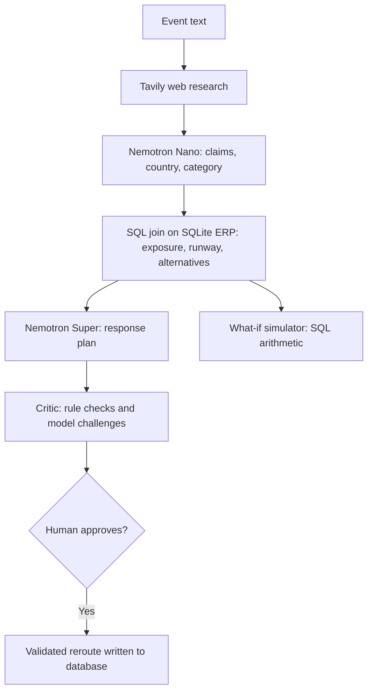

# CrisisSentinel

An agent that investigates a real-world supply disruption, works out what it means for a company's open purchase orders using SQL, and prepares a response plan for a human to approve.

[](LICENSE)

Built for the Nebius x NVIDIA Global AI Hackathon. Models: NVIDIA Nemotron on Nebius Token Factory. Web research: Tavily.

## The problem

When a fab shuts down in Taiwan or a port closes in Japan, a manufacturer needs three answers within hours: does this affect us, how badly, and what should we do?

News tells you what happened. It does not tell you that purchase order PO10482 for part MCU-X200 ships to the Stuttgart plant, where stock covers 10.9 days.

Language models are good at reading news and bad at arithmetic. Left alone, they invent supplier names and business numbers. CrisisSentinel gives each job to the tool that is good at it: models read and reason, SQL does the numbers.

## How it works

| Stage               | Done by                                                                         | Output                                                                                                            |
| ------------------- | ------------------------------------------------------------------------------- | ----------------------------------------------------------------------------------------------------------------- |
| 1. Web research     | Tavily, 3 planned queries (what happened, automotive impact, recovery timeline) | Up to 10 sources                                                                                                  |
| 2. Claim extraction | Nemotron Nano                                                                   | Claims that cite source ids, plus the affected country and category                                               |
| 3. Conflict check   | Nemotron Nano and a follow-up Tavily search                                     | Conflicting claims. A conflict counts as resolved only if a model cites a follow-up source that supports one side |
| 4. ERP exposure     | SQL only                                                                        | Value at risk, exposed POs, inventory runway per plant, approved alternative suppliers                            |
| 5. Response plan    | Nemotron Super                                                                  | Up to 3 actions, each tied to a real PO                                                                           |
| 6. Critic audit     | Rule checks, then Nemotron Super                                                | Every number re-checked against SQL, plus model-written challenges to the plan                                    |
| 7. Human approval   | You                                                                             | Reroutes are written to the database, each checked against the approved alternatives for that PO                  |



### Design rules

- **No AI-generated numbers.** Value at risk, runway, stoppage days and order values come from SQL or Python, never from a model.
- **The model cannot point at the wrong thing.** The plant, material and value of every action are copied from the PO's ERP record. A reroute to a supplier the ERP does not approve for that PO is dropped.
- **Failures are visible.** If a model call fails, the stage is labelled (`SQL fallback`, `Not independently reviewed`, `Degraded`) and the model gets no credit. An event that cannot be interpreted reports "no exposure identified" instead of falling back to a canned scenario.
- **Claims are traceable.** Every claim links to the web page it came from.
- **The critic's verdict is earned.** It comes from failed checks and the severity of challenges, not from a score. After a revision, the critic audits the new plan again and may still object.

## Where Nebius, NVIDIA and Tavily are used

- **Nebius Token Factory** serves all inference through its OpenAI-compatible API. Model IDs are looked up from `models.list()` at runtime because the casing differs between models, with documented fallbacks.
- **NVIDIA Nemotron** is split by task. Nano handles high-volume extraction and conflict judging. Super handles the plan, the critic and the revision. The UI shows which model produced each stage.
- **Tavily** is the research layer: a planned multi-query search, then targeted follow-up searches when claims conflict. At most 6 searches per scan.

## Running it

You need Python 3.10+, Node 18+, a Nebius Token Factory key and a Tavily key.

```bash
# 1. Backend
cd backend
python -m venv .venv && source .venv/bin/activate      # Windows: .venv\Scripts\activate
pip install -r requirements.txt
cp ../.env.example .env                                # then add NEBIUS_API_KEY and TAVILY_API_KEY
python seed_data.py                                    # creates voltauto.db
uvicorn api:app --port 8000

# 2. Frontend (in a second terminal)
cd frontend
npm install
npm run dev                                            # http://localhost:5173
```

The backend works from any directory. Without API keys, the UI starts in Recorded mode, which replays three saved live runs from `backend/cache/scenarios/` and needs no network.

Other commands:

```bash
python backend/main.py "Taiwan semiconductor supply chain disruption"   # full pipeline in the terminal
python scripts/record_scenarios.py                                      # re-record the three scenarios (needs keys)
python backend/eval_benchmark.py --offline                              # check the SQL engine against an independent oracle
python backend/eval_benchmark.py                                        # also measures live extraction accuracy (needs keys)
```

Optional environment variables:

| Variable          | Meaning                                                  | Default |
| ----------------- | -------------------------------------------------------- | ------- |
| `SCAN_RATE_LIMIT` | Live scans per IP per 10 minutes                         | 8       |
| `CORS_ORIGINS`    | Comma-separated allowed origins                          | `*`     |
| `VITE_API_URL`    | Backend URL for the frontend, if it is on another origin | none    |

## Demo walkthrough (3 minutes)

1. **Investigate.** Run the Taiwan semiconductor scenario in Live mode and watch each pipeline stage start and finish in real time.
2. **Read the numbers.** The four KPIs are tagged `SQL`. Open the Evidence tab and click a source link.
3. **Challenge the plan.** The critic lists failed rule checks (if any), single-supplier concentration, and model-written objections. Click Revise plan: the plan is rewritten and audited again.
4. **Try the what-if.** Drag the disruption length and capacity sliders. The benefit of rerouting recalculates instantly with no model call.
5. **Approve.** The reroutes are written to the database and the value at risk drops. Reset demo data restores the starting state.

## The data

`voltauto.db` is a synthetic, SAP-inspired dataset for a fictional German EV manufacturer, VoltAuto GmbH. It has 21 suppliers, 50 materials, 5 plants, 199 purchase orders and a set of approved alternative suppliers. It is not connected to SAP and does not claim to be. What matters is the relationships: supplier country and category, material, PO, plant, inventory, and approved alternative.

| Scenario              | Exposed open POs | Value at risk | Shortest runway |
| --------------------- | ---------------- | ------------- | --------------- |
| Taiwan semiconductors | 11               | €4.72M        | 3.2 days        |
| Poland batteries      | 12               | €6.17M        | 2.2 days        |
| Germany batteries     | 11               | €6.78M        | 4.2 days        |
| Japan sensors         | 42               | €17.15M       | 1.0 day         |

## Testing

- `cd backend && pytest -q` runs 31 offline tests. Models and Tavily are stubbed, so no network is needed. They cover the failure modes above: no invented events, conflicts resolved only with cited evidence, unapproved suppliers refused, plant and material taken from the ERP, honest provenance, real revisions, streaming order and rate limiting.
- `cd frontend && npm test` runs 12 component tests that render the real UI against payloads produced by the real backend.
- `python backend/eval_benchmark.py --offline` runs 20 checks comparing the engine to an independent SQL oracle across four scenarios. All 20 pass.
- Live extraction accuracy has to be measured with your own keys (`python backend/eval_benchmark.py`). Results go to `backend/eval_results.json`. We do not quote a figure that has not come from that run.

## Known limitations

- The data is synthetic and there is no live ERP integration.
- The what-if model assumes the same capacity loss across a whole region and a straight-line drop in inventory. It also uses the PO lead time as a stand-in for an alternative supplier's lead time. These assumptions are listed in the UI.
- Events are matched to suppliers by country and category, so every supplier in that country and category is treated as equally affected.
- Evidence strength is a simple heuristic (distinct domains minus unresolved conflicts), not a probability.
- Supplier capacity and qualification cannot be checked from the data, so the critic raises them as questions for a human.
- SQLite and the in-memory rate limiter are fine for a single-instance demo, not for production. There is no authentication.

## Feedback on the platforms

- **Token Factory model IDs are inconsistent in casing** (`nvidia/NVIDIA-Nemotron-3-Nano-30B-A3B` versus `nvidia/nemotron-3-super-120b-a12b`), so looking IDs up from `models.list()` is safer than hard-coding them.
- **Nemotron reasoning models can return output that is not plain JSON** (empty `content`, reasoning tags, or fenced blocks), even in JSON mode. Every call therefore goes through a tolerant parser with an explicit `max_tokens` and retries.
- **Tavily snippets are short.** Claim extraction works from snippets, so source quality and query wording matter more than the number of results.

## Team

- Vivek Sawant: backend orchestration, deterministic engine, Nebius and Nemotron integration
- Dhruva Makwana: ERP database design, seeding, benchmark and test scenarios
- Dhruval Makwana: frontend

## License

MIT. See [LICENSE](LICENSE).
